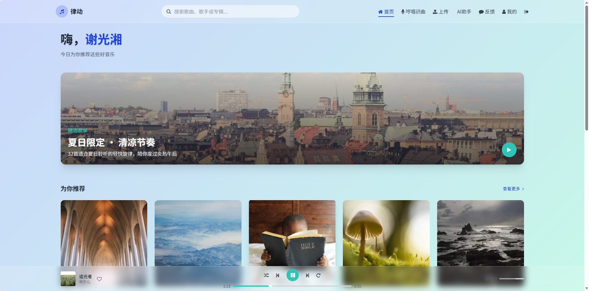
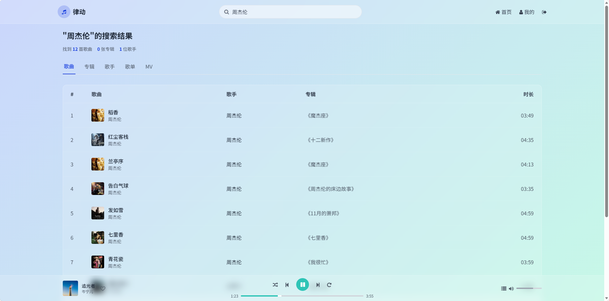
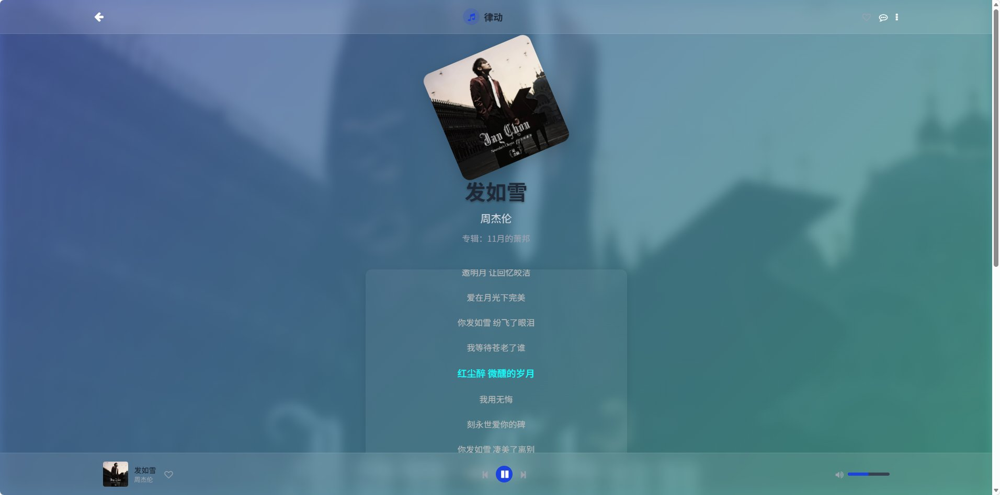

# LvDong-Music · 律动音乐

《律动音乐》是一个基于传统 Java Servlet 技术栈的音乐流媒体网站，包含用户体系、在线播放、评论互动、歌曲上传与哼唱识曲等模块。

项目没有使用 Spring 等框架，Servlet → Service → DAO 三层手写实现，适合作为理解 JavaWeb 请求分发、原生 JDBC 与连接池、JWT 认证的实践参考。

## 界面预览

**首页**：渐变背景搭配推荐歌单卡片，底部为常驻播放栏，支持歌词、播放模式与音量控制。



**搜索结果**：按歌曲、专辑、歌手、歌单、MV 分类展示，列表含封面、专辑与时长，点击即刻播放。



**播放页**：全屏模糊封面背景，滚动歌词逐行高亮，支持评论与分享。



## 功能特性

**用户**

- 邮箱验证码注册、登录、找回密码
- JWT 双 Token 认证（accessToken 30 分钟 / refreshToken 7 天），支持登出与 Token 刷新
- 个人资料、头像与密码修改

**音乐**

- HLS 分片流媒体播放，前端通过 HLS.js 播放并自定义 m3u8 加载器
- 歌词同步展示、封面与专辑信息
- 关键词搜索与分类浏览
- 歌曲上传，按「审核中 / 审核通过 / 审核不通过」管理状态
- 音乐人申请与审核状态查询

**互动**

- 歌曲点赞与收藏
- 评论、多级回复、评论点赞
- 问题反馈

**其他**

- 哼唱识曲：录音上传后调用讯飞 webqbh 接口识别歌曲
- AI 助手页面（前端模拟交互，未接入大模型）
- WebSocket 实时通道
- Tailwind CSS 响应式布局

## 技术栈

| 分类 | 技术 |
| --- | --- |
| 后端 | Java 16+、Servlet 3.1、原生 JDBC、HikariCP 连接池 |
| 数据库 | MySQL 8.0（10 张表，utf8mb4） |
| 认证 | JJWT 0.9.1、jBCrypt 密码哈希 |
| JSON | Gson |
| 日志 | SLF4J + Logback |
| 媒体处理 | FFmpeg（音频转 HLS 切片） |
| 前端 | 原生 HTML/CSS/JS、Tailwind CSS、Axios、HLS.js（CDN 引入） |
| 构建与部署 | Maven（WAR 包）、Tomcat 9 |

## 目录结构

```
ListenToMusic
├── src/main/java
│   ├── servlet/      控制器，BaseServlet 通过 ?action= 反射分发
│   ├── service/      业务逻辑层（含 impl 实现）
│   ├── dao/          数据访问层，原生 JDBC（含 impl 实现）
│   ├── pojo/         实体类
│   ├── filter/       CORS 与 JWT 校验过滤器
│   ├── annotation/   @ParamName 请求参数绑定
│   └── utils/        配置读取、JWT、雪花 ID、邮件、HLS 等工具
├── src/main/resources
│   ├── application.properties.example   配置模板（复制后填写）
│   ├── sql/lvdong_music_db.sql          数据库建表脚本
│   └── logback.xml
├── src/main/webapp                      页面与静态资源
├── doc/                                 项目文档与界面截图
└── pom.xml
```

## 快速开始

### 环境要求

- JDK 16 及以上（推荐 17）
- Maven 3.6+
- MySQL 8.0
- Tomcat 9.x
- FFmpeg（可选，HLS 转码需要）

> 项目基于 `javax.servlet`，Tomcat 10 及以上已迁移到 `jakarta.*` 命名空间，无法直接使用。

### 1. 初始化数据库

```sql
CREATE DATABASE lvdong_music_db DEFAULT CHARACTER SET utf8mb4 COLLATE utf8mb4_0900_ai_ci;
```

```bash
mysql -uroot -p lvdong_music_db < src/main/resources/sql/lvdong_music_db.sql
```

脚本只包含表结构，不含示例数据。

### 2. 准备配置文件

```bash
cp src/main/resources/application.properties.example src/main/resources/application.properties
```

按文件内注释填写数据库账号、JWT 密钥与存储路径。`application.properties` 已在 `.gitignore` 中，不会被提交。

### 3. 构建

```bash
mvn clean package
```

生成 `target/ListenToMusic.war`。

### 4. 部署到 Tomcat

将 WAR 复制到 Tomcat 的 `webapps` 目录，并重命名为 `xgxmusic.war`：

```bash
cp target/ListenToMusic.war $CATALINA_HOME/webapps/xgxmusic.war
```

> 页面中的 `base href` 与 Axios `baseURL` 硬编码为 `/xgxmusic`，因此 context path 必须保持为 `xgxmusic`，否则接口请求会 404。

启动 Tomcat 后访问：<http://localhost:8080/xgxmusic/>

## 配置说明

| 配置项 | 说明 |
| --- | --- |
| `db.url` / `db.username` / `db.password` | MySQL 连接信息 |
| `jwt.access.secret` / `jwt.refresh.secret` | Token 签名密钥，须为 Base64 字符集，可用 `openssl rand -hex 32` 生成 |
| `jwt.access.expire` / `jwt.refresh.expire` | Token 有效期（毫秒） |
| `smtp.*` | 邮箱验证码发送，未配置时注册与找回密码不可用 |
| `storage.tomcat.path` | 歌曲、封面等静态资源存放目录（需 Tomcat 可访问） |
| `storage.project.path` | 项目 webapp 目录，用于本地资源同步 |
| `ffmpeg.path` / `hls.root.dir` | FFmpeg 可执行文件路径与 HLS 切片输出目录 |
| `cors.allowed.origins` | 允许的跨域来源，逗号分隔 |
| `qbh.appid` / `qbh.api.key` | 讯飞哼唱识别凭证，未配置时识曲功能不可用 |

所有配置项都支持环境变量覆盖，优先级高于配置文件，例如 `DB_PASSWORD`、`JWT_ACCESS_SECRET`。

## 接口约定

后端接口统一通过 `?action=方法名` 分发：`BaseServlet` 用反射调用对应方法，参数经 `@ParamName` 注解绑定，响应为 Gson 序列化的 JSON。

| 端点 | 职责 |
| --- | --- |
| `/userServlet` | 登录、注册、找回密码、登出、刷新 Token、修改资料 |
| `/authServlet` | 邮箱验证码发送与校验 |
| `/musicServlet` | 歌曲上传 |
| `/singerServlet` | 音乐人申请与审核状态查询 |
| `/searchServlet` | 歌曲搜索 |
| `/commentServlet` | 发表评论、评论列表、评论数量、评论点赞 |
| `/favoriteServlet` | 收藏与取消收藏 |
| `/recognitionServlet` | 哼唱识曲 |
| `/hls` | HLS 播放列表与切片输出 |

受保护接口需要在请求头携带 `Authorization: Bearer <accessToken>`，公开页面与登录、注册等 action 在 `TokenFilter` 中白名单放行。

## 说明

- 本项目为学习实践项目，代码中的音乐、图片等资源版权归原作者所有，请勿用于商业用途。
- 数据库口令、JWT 密钥、第三方接口密钥请通过本地配置文件或环境变量提供，不要提交到仓库。
